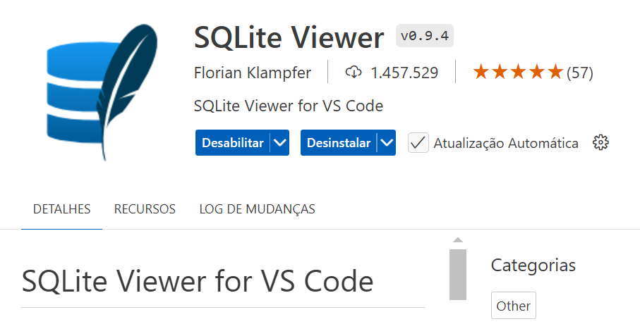
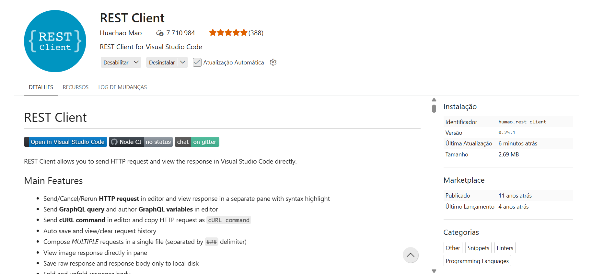

# API CRUD com Node.js, JavaScript, Express, SQLite e padrão DAO

Este projeto demonstra como separar uma API HTTP das regras de acesso ao banco de dados SQLite. 

O Express recebe as requisições, enquanto a classe `UsuarioDAO` concentra os comandos SQL.

## Tecnologias

- Node.js
- JavaScript
- Express
- SQLite 
- Extensão REST Client para o VS Code

## SQLite Viewer

No Codespace, instalar a extensão (plugin) VS Code `SQLite Viewer`: 



## Rest Client

No Codespace, instalar a extensão (plugin) VS Code `REST Client`: 



### Comandos Iniciais

```bash
sudo apt update
```

```bash
sudo apt install -y nodejs
```

```bash
node -v
```

```bash
npm install -g npm@11.19.0
```

```bash
npm -v
```

### Iniciar um projeto `Node.js`:

```bash
npm init -y
```

Os arquivos da aplicação são escritos em JavaScript e executados pelo Node.js.

Crie o arquivo `.gitignore` com o conteúdo abaixo:

```txt
node_modules/
```

### Variável de Ambiente

Criar o arquivo `.env`.

O arquivo `.env` é opcional e deve ficar na raiz do projeto. 

Para definir um caminho personalizado para o banco, crie o arquivo com o conteúdo abaixo:

```txt
PORT=3001
SQLITE_DB_PATH=./src/database/banco_de_dados.db
```

Se o arquivo `.env` não existir ou as variáveis de ambiente `PORT` e `SQLITE_DB_PATH` não estiverem definidas, a aplicação usará a porta `3000` e banco de dados em `.src/database/teste.db`. 

Para um caminho personalizado, a pasta indicada deve existir e permitir gravação. 

**OBS**: o SQLite cria o arquivo do banco, mas não cria as pastas. Então, criar a pasta:

```txt
./src/database/
```

### package.json

No arquivo `package.json`, substituir `"type": "commonjs",`  por `"type": "module",`:

Inserir as linhas:

```json
    "dev": "node --env-file-if-exists=.env --watch ./src/Main.js",
    "start": "npm run dev"
```

```json
{
  "name": "node-javascript-bd-sqlite-05-dao",
  "version": "1.0.0",
  "description": "",
  "main": "index.js",
  "scripts": {
    "test": "echo \"Error: no test specified\" && exit 1",
    "dev": "node --env-file-if-exists=.env --watch ./src/Main.js",
    "start": "npm run dev"
  },
  "repository": {
    "type": "git",
    "url": "git+https://github.com/wdiasmaciel/node-javascript-bd-sqlite-05-dao.git"
  },
  "keywords": [],
  "author": "",
  "license": "ISC",
  "type": "module",
  "bugs": {
    "url": "https://github.com/wdiasmaciel/node-javascript-bd-sqlite-05-dao/issues"
  },
  "homepage": "https://github.com/wdiasmaciel/node-javascript-bd-sqlite-05-dao#readme",
  "dependencies": {
    "express": "^5.3.0"
  }
}
```

## Estrutura e padrão DAO

- `src/Main.js`: configura o servidor Express e os endpoints.
- `src/model/Usuario.js`: representa um usuário e seus atributos.
- `src/dao/UsuarioDAO.js`: traduz a operação do domínio em comandos SQL.
- `src/database/ConnectionFactory.js`: centraliza a abertura da conexão SQLite.

1. O padrão DAO evita que rotas e regras HTTP misturem SQL diretamente. 

2. Assim, a mesma classe de acesso pode ser reutilizada por interfaces de linha de comando, APIs ou outras aplicações.

### Main.js

```js
import express from "express";
import { UsuarioDAO } from "./dao/UsuarioDAO.js";
import { Usuario } from "./model/Usuario.js";

// A aplicação Express recebe as requisições e delega o acesso aos dados ao DAO.
const app = express();
const usuarioDAO = new UsuarioDAO();
const port = Number(process.env.PORT ?? 3000);

app.use(express.json());
usuarioDAO.createTable();

// Valida os dados do corpo antes de criar ou atualizar um usuário.
function validarUsuario(nome, nascimento) {
  if (typeof nome !== "string" || nome.trim() === "") {
    return "O campo nome deve ser informado.";
  }

  if (nascimento !== undefined && nascimento !== null && typeof nascimento !== "string") {
    return "O campo nascimento deve ser uma data em formato texto (AAAA-MM-DD).";
  }

  return null;
}

// GET /usuarios: lista todos os usuários cadastrados.
app.get("/usuarios", (request, response) => {
  response.json(usuarioDAO.readAll());
});

// GET /usuarios/:id: busca um usuário pelo identificador.
app.get("/usuarios/:id", (request, response) => {
  const id = Number(request.params.id);
  const usuario = usuarioDAO.read(id);

  if (!usuario) {
    response.status(404).json({ mensagem: "Usuário não encontrado." });
    return;
  }

  response.json(usuario);
});

// POST /usuarios: insere um novo usuário e devolve o registro com seu id.
app.post("/usuarios", (request, response) => {
  /*
   * Se request.body.nascimento existir, seu valor será usado.
   * Se a propriedade for undefined ou não existir, nascimento receberá null.
   */
  const { nome, nascimento = null } = request.body;

  const erro = validarUsuario(nome, nascimento);

  if (erro) {
    response.status(400).json({ mensagem: erro });
    return;
  }

  const usuario = usuarioDAO.create(new Usuario(0, nome, nascimento));
  response.status(201).location(`/usuarios/${usuario.id}`).json(usuario);
});

// PUT /usuarios/:id: substitui os dados informados para um usuário existente.
app.put("/usuarios/:id", (request, response) => {
  const id = Number(request.params.id);

  /*
   * Se request.body.nascimento existir, seu valor será usado.
   * Se a propriedade for undefined ou não existir, nascimento receberá null.
   */
  const { nome, nascimento = null } = request.body;
  
  const erro = validarUsuario(nome, nascimento);

  if (erro) {
    response.status(400).json({ mensagem: erro });
    return;
  }

  const usuario = new Usuario(id, nome, nascimento);
  const atualizado = usuarioDAO.update(usuario);

  if (!atualizado) {
    response.status(404).json({ mensagem: "Usuário não encontrado." });
    return;
  }

  response.json(usuario);
});

// DELETE /usuarios/:id: remove o usuário informado pelo identificador.
app.delete("/usuarios/:id", (request, response) => {
  const id = Number(request.params.id);
  const usuario = usuarioDAO.read(id);

  if (!usuario) {
    response.status(404).json({ mensagem: "Usuário não encontrado." });
    return;
  }

  usuarioDAO.delete(usuario);
  response.status(204).send();
});

// Resposta simples para verificar se o serviço está disponível.
app.get("/", (request, response) => {
  response.json({ mensagem: "API de usuários ativa", recursos: "/usuarios" });
});

// Trata falhas inesperadas sem interromper o servidor.
app.use((error, request, response, next) => {
  console.error(error);
  response.status(500).json({ mensagem: "Erro interno do servidor." });
});

app.listen(port, () => {
  console.log(`API disponível em http://localhost:${port}`);
});
```

### Usuario.js
```js
export class Usuario {
  constructor(id, nome, nascimento) {
    this.id = id;
    this.nome = nome;
    this.nascimento = nascimento;
  }
}
```

### UsuarioDAO.js

```js
import { ConnectionFactory } from "../database/ConnectionFactory.js";
import { Usuario } from "../model/Usuario.js";

export class UsuarioDAO {
  constructor() {
    this.connectionFactory = new ConnectionFactory();
  }  
  
  // Método para criar a tabela Usuário:
  createTable() {
    this.withConnection((connection) => {
      connection.exec(`
        CREATE TABLE IF NOT EXISTS usuario (
          id INTEGER PRIMARY KEY AUTOINCREMENT,
          nome VARCHAR(256) NOT NULL,
          nascimento TEXT
        )
      `);
      console.log("Tabela 'usuario' criada ou já existe!");
    });
  }

  // Método para inseriri um registro na tabela Usuário:
  create(usuario) {
    return this.withConnection((connection) => {
      connection
        .prepare("INSERT INTO usuario (nome, nascimento) VALUES (?, ?)")
        .run(usuario.nome, usuario.nascimento);

      usuario.id = this.readLastInsertedId(connection);
      console.log(`
        USUÁRIO GRAVADO NO BANCO DE DADOS: \n
        ID: ${usuario.id}\n
        NOME: ${usuario.nome}\n
        DATA DE NASCIMENTO: ${usuario.nascimento}
      `);
      return usuario;
    });
  }

  // Método para ler a chave primária do último registro inserido na tabela Usuário:
  readLastInsertedId(connection) {
    const row = connection
      .prepare("SELECT last_insert_rowid() AS id")
      .get();
    if (!row || typeof row.id !== "number") {
      throw new Error("Não foi possível recuperar o identificador gerado.");
    }
    return row.id;
  }

  // Método para listar todos os usuários; usado pela rota GET /usuarios.
  readAll() {
    return this.withConnection((connection) => {
      const rows = connection
        .prepare("SELECT id, nome, nascimento FROM usuario ORDER BY id")
        .all();
      return rows.map((row) => this.mapRowToUsuario(row));
    });
  }

  // Método para ler um registro inserido na tabela Usuário:
  read(id) {
    return this.withConnection((connection) => {
      const row = connection
        .prepare("SELECT id, nome, nascimento FROM usuario WHERE id = ?")
        .get(id);

      if (!row) {
        return null;
      }

      return this.mapRowToUsuario(row);
    });
  }

  // Método para atualizar/modificar um registro inserido na tabela Usuário:
  update(usuario) {
    return this.withConnection((connection) => {
      const result = connection
        .prepare("UPDATE usuario SET nome = ?, nascimento = ? WHERE id = ?")
        .run(usuario.nome, usuario.nascimento, usuario.id);
      return result.changes > 0;
    });
  }

  // Método para excluir um registro inserido na tabela Usuário:
  delete(usuario) {
    this.withConnection((connection) => {
      connection
        .prepare("DELETE FROM usuario WHERE id = ?")
        .run(usuario.id);
      console.log(`O usuario ${usuario.nome} foi removido do BD.`);
    });
  }

  mapRowToUsuario(row) {
    if (
      typeof row.id !== "number" ||
      typeof row.nome !== "string" ||
      (typeof row.nascimento !== "string" && row.nascimento !== null)
    ) {
      throw new Error("O banco retornou um registro de usuário inválido.");
    }

    return new Usuario(row.id, row.nome, row.nascimento);
  }

  withConnection(operation) {
    const connection = this.connectionFactory.createConnection();
    try {
      return operation(connection);
    } finally {
      connection.close();
    }
  }
}
```

### ConnectionFactory.js

```js
import { DatabaseSync } from "node:sqlite";
import { dirname, resolve } from "node:path";
import { fileURLToPath } from "node:url";

/*
 * import.meta.url é uma metapropriedade disponível nos 
 * módulos JavaScript. Ela contém a URL do módulo atual.
 * No Windows, seu valor seria semelhante a:
 * file:///C:/Users/.../node-typescript-api-crud-com-express-sqlite-e-padrao-dao/src/database/ConnectionFactory.js
 * Depois, dirname(...) obtém somente o diretório desse arquivo:
 * C:/Users/.../node-typescript-api-crud-com-express-sqlite-e-padrao-dao/src/database
 */
const defaultDatabasePath = resolve(
  dirname(fileURLToPath(import.meta.url)),
  "./", // O banco de dados será criado no diretório corrente.
  "teste.db", // Nome do arquivo do banco de dados.
);

export class ConnectionFactory {

  /*
   * ??: usa o caminho padrão apenas quando SQLITE_DB_PATH é null ou undefined. 
   * ||: também usa o padrão quando o valor é vazio (""), 0 ou false.
   * Como variáveis de ambiente são strings, a diferença prática aqui é quando 
   * SQLITE_DB_PATH existe, mas está vazia:
   * ??: mantém "" como caminho.
   * ||: trata "" como não configurada e usa defaultDatabasePath.
   * Se um valor vazio deve significar “usar o padrão”, use ||. 
   * Se prefere detectar e reportar uma configuração vazia como inválida, mantenha ?? 
   * e valide-a explicitamente.
   */
  constructor() {
    this.databasePath = process.env.SQLITE_DB_PATH ?? defaultDatabasePath;
  }

  createConnection() {
    try {
      const connection = new DatabaseSync(this.databasePath);
      console.log("Conexão com SQLite estabelecida!");
      return connection;
    } catch (error) {
      console.error("Não foi possível estabelecer conexão com SQLite!");
      throw error;
    }
  }
}

/*
 * O || avalia os valores "falsy":
 * null
 * undefined
 * ""
 * 0
 * false
 * NaN
 * 0n.
 * No código, por ser uma variável de ambiente, 
 * process.env.SQLITE_DB_PATH será tipicamente 
 * uma string:
 * this.databasePath = process.env.SQLITE_DB_PATH || defaultDatabasePath;
 * Assim, uma string vazia ("") usa defaultDatabasePath. 
 * Diferentemente de ??, que mantém "":
 * this.databasePath = process.env.SQLITE_DB_PATH ?? defaultDatabasePath;
 * 
 * Deixe || se uma variável vazia ("") deve ser tratada como 
 * não configurada:
 * this.databasePath = process.env.SQLITE_DB_PATH || defaultDatabasePath;
 * Troque por ?? se você quer aceitar somente null ou undefined 
 * como ausência:
 * this.databasePath = process.env.SQLITE_DB_PATH ?? defaultDatabasePath;
 * Neste caso, uma string vazia será mantida como caminho e poderá 
 * causar erro ao abrir o banco. Como process.env tipicamente usa 
 * apenas strings, strings vazias devem ser validadas ou tratadas 
 * com ||:
 * const configuredPath = process.env.SQLITE_DB_PATH?.trim();
 * this.databasePath = configuredPath || defaultDatabasePath;
 * 
 * Para o comportamento mais esperado de uma variável de ambiente 
 * opcional, mantenha ||.
 */
```

## Executar

Instale as dependências e inicie o servidor:

```bash
npm install express
```

```bash
npm install
```

```bash
npm start
```

Saída:

```text
npm start

> node-javascript-bd-sqlite-05-dao@1.0.0 start
> npm run dev


> node-javascript-bd-sqlite-05-dao@1.0.0 dev
> node --env-file-if-exists=.env --watch ./src/Main.js

Conexão com SQLite estabelecida!
Tabela 'usuario' criada ou já existe!
API disponível em http://localhost:3000
```

A API ficará disponível em `http://localhost:3000`. 

1. Para alterar a porta, defina a variável `PORT`; 

2. Para alterar o banco, defina `SQLITE_DB_PATH`.

## Rotas da API

| Método | Rota | Finalidade |
|---|---|---|
| `GET` | `/` | Verifica se a API está ativa |
| `GET` | `/usuarios` | Lista todos os usuários |
| `GET` | `/usuarios/:id` | Busca um usuário pelo id |
| `POST` | `/usuarios` | Cadastra um usuário |
| `PUT` | `/usuarios/:id` | Atualiza um usuário existente |
| `DELETE` | `/usuarios/:id` | Remove um usuário |

Exemplo de criação de usuário:

```json
{
  "nome": "Ana Silva",
  "nascimento": "2000-06-07"
}
```

## Testando com REST Client

1. Instale a extensão **REST Client** no VS Code.
2. Inicie a API com `npm start`.
3. Criar o arquivo `teste.http`:

```http
### API de usuários - arquivo REST Client
@port = 3001
@baseUrl = http://localhost:{{port}}

### Verificar se a API está ativa
GET {{baseUrl}}/

### Listar todos os usuários
GET {{baseUrl}}/usuarios

### Buscar usuário pelo id
GET {{baseUrl}}/usuarios/1

### Criar usuário
POST {{baseUrl}}/usuarios
Content-Type: application/json

{
  "nome": "Ana Silva",
  "nascimento": "2000-06-07"
}

### Criar usuário sem data de nascimento
POST {{baseUrl}}/usuarios
Content-Type: application/json

{
  "nome": "Bruna Gomes"
}

### Atualizar usuário
PUT {{baseUrl}}/usuarios/1
Content-Type: application/json

{
  "nome": "Ana Martins",
  "nascimento": "2000-06-07"
}

### Excluir usuário
DELETE {{baseUrl}}/usuarios/1

### Testar validação de usuário inválido
POST {{baseUrl}}/usuarios
Content-Type: application/json

{
  "nome": ""
}
```
4. Clique em **Send Request** acima da requisição desejada.


## Exercícios

1. **Biblioteca:** implemente o CRUD de livros e autores. Crie as entidades `Autor(id, nome, nacionalidade)` e `Livro(id, titulo, ano_publicacao, id_autor)`, incluindo rotas REST para pesquisar livros pelo autor.

2. **Hotel:** implemente o CRUD de quartos, hóspedes e reservas. Crie `Quarto(id, numero, tipo, diaria)`, `Hospede(id, nome, documento)` e `Reserva(id, id_quarto, id_hospede, entrada, saida, total)`. Garanta que uma alteração não apague o vínculo do quarto e do hóspede.

3. **Streaming:** modele filmes, categorias e assinaturas. Desenvolva os DAOs de `Categoria`, `Filme` e `Assinatura`, com uma rota que liste os filmes de uma categoria selecionada pelo id.

4. **Oficina mecânica:** implemente o cadastro de clientes, veículos e ordens de serviço. Considere `Cliente(id, nome, telefone)`, `Veiculo(id, placa, modelo, id_cliente)` e `OrdemServico(id, id_veiculo, descricao, valor, status)`, incluindo atualização exclusiva do status.

5. **Festival de música:** crie recursos para palcos, artistas e apresentações. Modele `Palco(id, nome, capacidade)`, `Artista(id, nome, genero_musical)` e `Apresentacao(id, id_palco, id_artista, data_apresentacao, horario,duracao)`, com uma API para consultar a programação de um dia informado.
